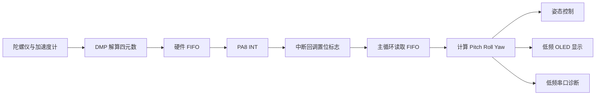

# FIFO、中断与多速率调度

## 1. 这类问题为什么课件里不明显

课件通常分别讲 IIC、中断、OLED、串口和传感器。实验中每个例程单独运行都可能正常，但把它们组合起来以后，系统还必须满足一个额外条件：所有任务的总执行时间不能妨碍关键数据被及时处理。

这不是某个 HAL 函数的语法问题，而是实时系统的整体行为。

## 2. MPU6050 数据从哪里来

本工程的数据流是：



DMP 在 MPU 芯片内部持续工作。STM32 没有及时读取时，数据不会自动变成主循环变量，而是先积压在 FIFO 中。

## 3. 中断标志为什么会丢信息

中断回调执行：

```c
mems_data_rdy_flag = 1U;
```

若主循环繁忙期间来了 20 次中断，变量仍然是 `1`，而不是 `20`。因此它只表达“至少发生过一次”，不能表达“积压了多少帧”。

这类标志适用于唤醒主循环，但主循环必须进一步查询 FIFO 状态，并把积压的数据处理掉。

## 4. 生产者与消费者

MPU/DMP 是生产者，STM32 主循环是消费者。

若输出频率为 200 Hz，则数据周期是：

$$
T=\frac{1}{200}=5\,\text{ms}.
$$

如果主循环处理一帧需要超过 5 ms，平均消费速度就低于生产速度，FIFO 会不断积压。

这个判断关注的不是代码有多少行，而是关键路径一次执行需要多长时间。

## 5. 为什么 `printf` 也可能造成故障

当前串口重定向使用阻塞发送。假设一次打印 50 个字符，115200 bit/s 下每字符包含起始位、8 位数据和停止位，粗略发送时间为：

$$
t\approx\frac{50\times10}{115200}\approx4.34\,\text{ms}.
$$

在 5 ms 的数据周期中，串口就可能占用约 4.34 ms。再加入 OLED 软件 IIC 和颜色传感器读取，主循环必然难以及时读取 FIFO。

因此调试输出不是“免费的观察”，它会改变系统时序。这称为观察者效应。

## 6. 多速率调度

不同任务不应该使用同一个执行频率。本工程调整后的频率是：

- DMP/FIFO：100 Hz。
- MPU 定时补读：每 10 ms。
- 姿态控制：每个有效姿态帧。
- 颜色采样：每 60 ms。
- OLED：每 200 ms。
- 姿态串口：每 200 ms。
- 颜色串口：每 300 ms。

控制需要及时，显示只需要让人眼看起来连续，串口日志只需要提供诊断证据。把它们解耦后，低优先级功能就不会阻塞关键数据链。

## 7. 为什么要同时使用中断和定时补读

中断能降低无意义轮询，但单独依赖边沿存在风险：

- 主循环繁忙时，多次中断合并为一个标志。
- INT 引脚持续保持有效电平时，可能没有新的下降沿。
- FIFO 溢出或复位后，中断时序可能与预期不同。

因此采用：

```text
收到中断标志
或距离上次读取已达到 10 ms
→ 尝试读取 FIFO
```

中断负责低延迟通知，定时补读负责容错。

## 8. 为什么不能先乘补偿系数

若读取的数据是旧帧或有一部分旋转区间被丢弃，乘以固定系数只能碰巧修正某一次测试。

标定前应依次确认：

1. FIFO 数据是否及时读取。
2. 角度单位是否为度。
3. $\pm180^\circ$ 是否正确展开。
4. 旋转方向符号是否正确。
5. 停止后数据是否到达最终姿态。
6. 最后才判断是否存在稳定、可重复的比例误差。

## 9. 三种不能混淆的“成功”

- 编译成功：语法、链接和工程配置能够生成固件。
- 初始化成功：STM32 能与 MPU 通信并启动 DMP。
- 实车成功：真实旋转角度、显示角度和控制行为满足实验要求。

前两项不能代替第三项。

## 10. 复习问题

1. 为什么连续发生 20 次外部中断后，`mems_data_rdy_flag` 仍可能只是 `1`？
2. 如果 OLED 刷新一次需要 30 ms，而 MPU 每 10 ms 产生一帧，FIFO 中的数据量会怎样变化？
